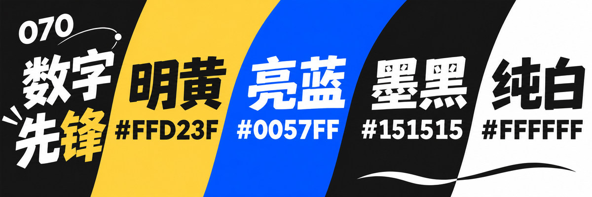

# 100种文章封面配色组合

把下面这句话发给Codex安装：

> 帮我安装「文章配色」，只安装这个文件夹：https://github.com/WoYun520/gif-factory/tree/main/skills/article-cover-palette

**这套Skill是帮文章选配色的，不负责制作封面。推荐搭配[Punk-Posters](https://github.com/adrianpunk/Punk-Posters)使用：这套选颜色，Punk负责封面设计和出图。**

装好后，发文章、标题或现有封面，说“用文章配色帮我选颜色”。也可以用`$article-cover-palette`调用。

## 看看配色

| 030 落日与海 | 070 数字先锋 |
| --- | --- |
|  |  |
| 橙、米色、钴蓝 | 黄、蓝、黑、白 |

[100张色卡＋色号](references/color-cards.md) · [用途与标题搭法](references/palette-table.md) · [CSV表格](references/palette-table.csv)

## 它会给你什么

- 一套主推配色，必要时再给两套有区别的备选，说明为什么适合这篇文章。
- 原始色号，以及底色、标题字、小字和点缀色怎么分。
- 哪些原有颜色要保留，例如照片里的肤色、产品颜色和数据图例。
- 一份配色方案交接单，可以交给Punk或其他封面工具继续使用。

包里有100套配色表、选色判断规则、交接模板和100张现成色卡。文章仍按教程、工具介绍、分析、经验、清单、故事情绪等少数用途判断，不需要分出100种文章。

已有配色更合适也可以保留；指定编号、品牌色或自定义HEX时，按你的要求来。

## 平时怎么用

1. 发正文、摘要或标题。链接读不到时补正文；只有标题也能先选，会说明依据有限。
2. 助手给出配色建议，写清理由和颜色分工。
3. 选好以后，你可以自己使用色号，或把方案交给Punk制作封面。

只选配色不需要安装Punk，也不需要画图工具。

## 搭配Punk更方便

[Punk-Posters](https://github.com/adrianpunk/Punk-Posters)是Adrian Punk的视觉生成Skill项目，能负责封面的构图、字体、风格和出图。这套负责补上文章选色与颜色分工。两套分别安装，使用时按Punk仓库的说明和许可执行；本包不附带其源码或风格库。

可以直接对助手说：

> 先用文章配色Skill给这篇文章选颜色，再把方案交给Punk做封面。保留我给的标题和素材，颜色与风格不合适时先说明。

这是让助手配合使用两套Skill，不是查表脚本自动调用Punk。只有这套时，仍然可以正常选色并导出方案。[看搭配方法](references/punk-pairing.md)。

## 可以直接这样说

> 读这篇文章，推荐一套配色，说明标题字、底色和点缀色怎么搭，不要出图。

> 我选030“落日与海”，把色号和用法整理给我。

> 看这张封面原来的颜色是否合适；要换的话只推荐颜色，构图和字体保留。

> 用我自己的颜色 #003049、#FDF0D5、#D62828，帮我分配底色、标题色和点缀色。

> 取070“数字先锋”的现成色卡，附上色号说明。

## 哪些AI能用，需要装什么

配色表和规则可以交给能读文件的AI参考。目前安装包按Codex的Skill结构整理，其他平台能否直接安装需要看各自支持情况，尚未逐个平台测试。

查表、选色和导出交接单的脚本只需要Python 3，不需要Pillow或FFmpeg，不联网、不调用付费API。能否运行脚本取决于所用AI有没有本地执行能力；没有也可以阅读配色表选色。

封面制作由后续工具负责，画图能力、账号额度与费用按那个工具计算。本包不自带生图模型、账号或额度。

## 色号以什么为准

实际用色以表里的HEX为准。现成色卡是AI视觉预览，不把JPG取色当原始色值。为了读字补充的黑白辅助字色会单独说明，不改原100套色号。

[Skill指引](SKILL.md) · [判断规则](references/article-to-palette.md) · [脚本参数](references/script-usage.md) · [数据说明](references/data-notes.md) · [脚本与文档许可](LICENSE)
