# 100 套配色色卡

按001—100排列，每组都列出卡片和原始HEX。展开一组看十张，点击卡片看原图。
色卡是AI视觉预览；实际用色按旁边的HEX。用途、情绪和标题搭法见[完整配色表](palette-table.md)。

001—010

| 编号与名称 | 色卡 | 原始色号 |
| --- | --- | --- |
| 001 紫黄电波 | 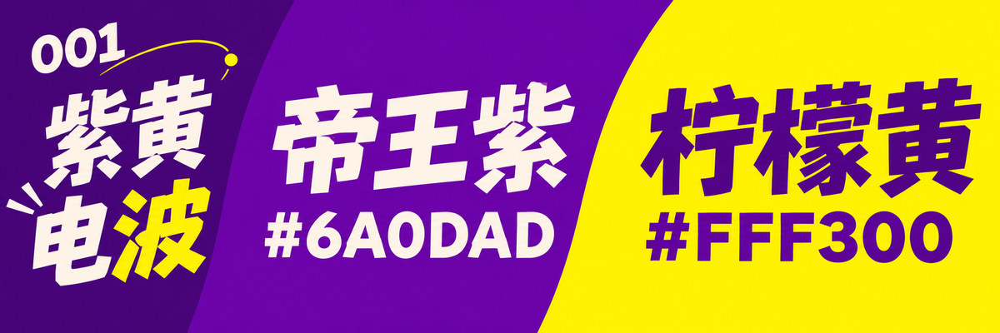 | 帝王紫 #6A0DAD 柠檬黄 #FFF300 |
| 002 莓夜霓虹 | 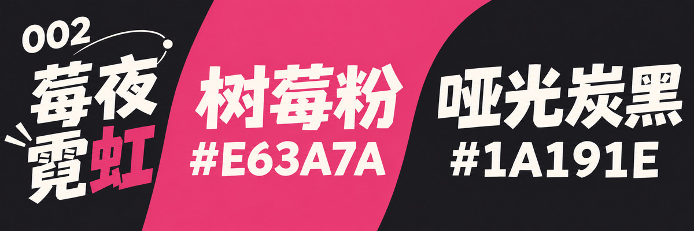 | 树莓粉 #E63A7A 哑光炭黑 #1A191E |
| 003 青柠脉冲 | 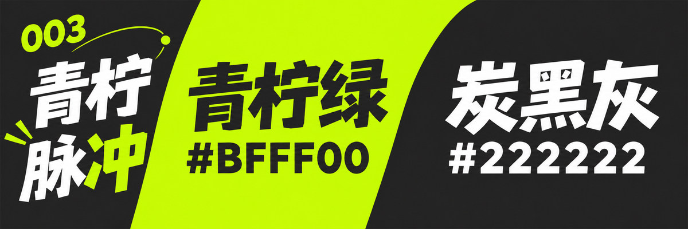 | 青柠绿 #BFFF00 炭黑灰 #222222 |
| 004 薄荷樱桃 | 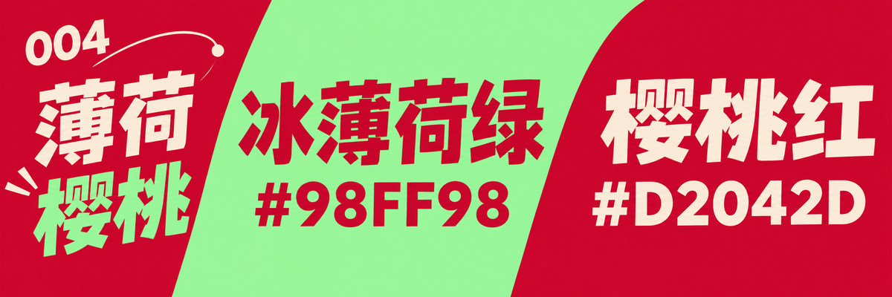 | 冰薄荷绿 #98FF98 樱桃红 #D2042D |
| 005 樱色森林 | 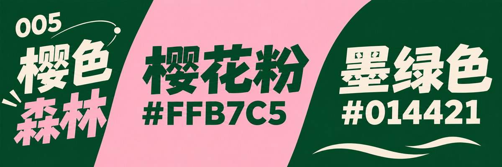 | 樱花粉 #FFB7C5 墨绿色 #014421 |
| 006 蓝橙节拍 |  | 钴蓝 #0047FF 橘光橙 #FF7A00 |
| 007 湖畔珊瑚 | 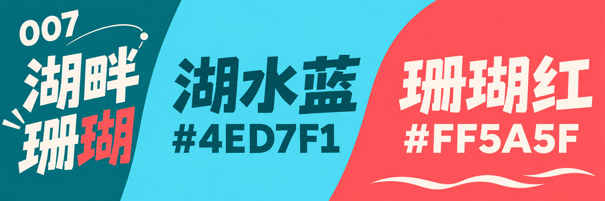 | 湖水蓝 #4ED7F1 珊瑚红 #FF5A5F |
| 008 橙调夜航 |  | 爱马仕橙 #FC8416 藏蓝色 #000035 |
| 009 蓝绿反差 | 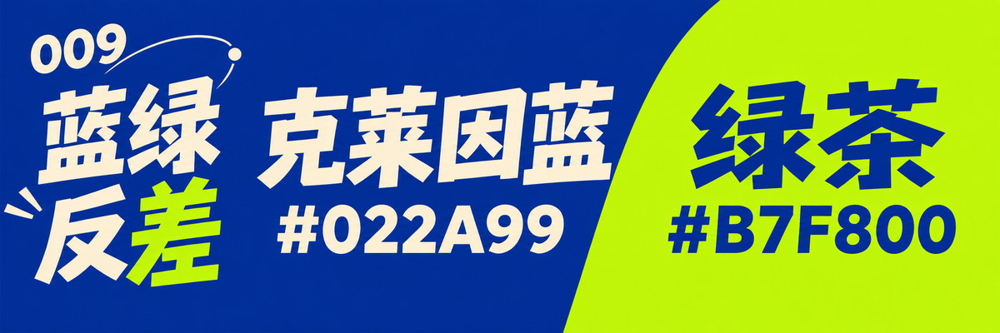 | 克莱因蓝 #022A99 绿茶 #B7F800 |
| 010 靛蓝玫影 |  | 青金石 #01008A 洋红 #FF0086 |

011—020

| 编号与名称 | 色卡 | 原始色号 |
| --- | --- | --- |
| 011 紫色闪光 |  | 晶石紫 #690DAD 柠檬黄 #FFFF00 |
| 012 绯红夜色 | 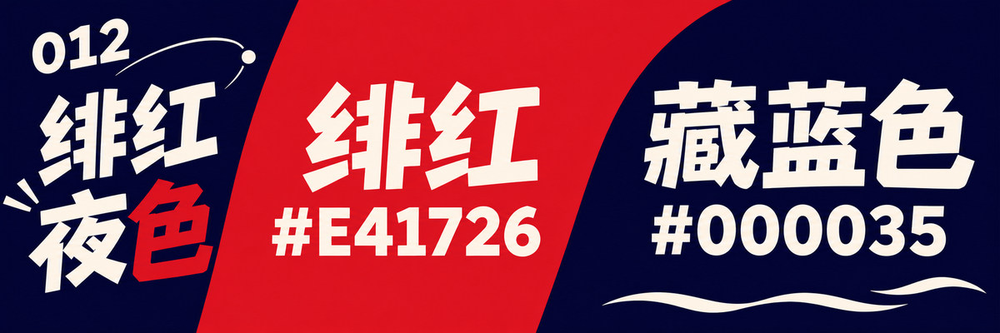 | 绯红 #E41726 藏蓝色 #000035 |
| 013 晴空明黄 |  | 靓丽黄 #FFFF00 海蓝 #0084D6 |
| 014 熔岩深绿 | 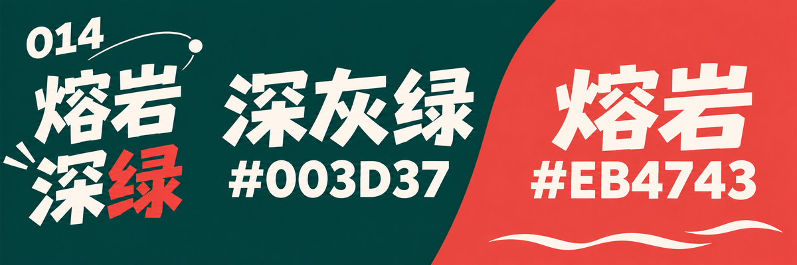 | 深灰绿 #003D37 熔岩 #EB4743 |
| 015 黑夜炽焰 | 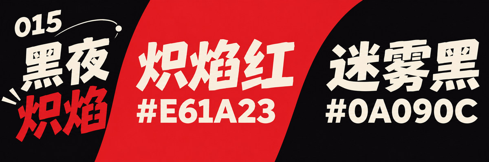 | 炽焰红 #E61A23 迷雾黑 #0A090C |
| 016 深海日光 |  | 深海宝蓝 #002FA7 阳光柠黄 #FFCF14 |
| 017 莓红暗场 | 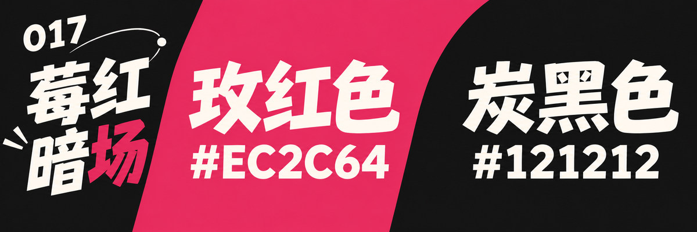 | 玫红色 #EC2C64 炭黑色 #121212 |
| 018 薄荷可可 | 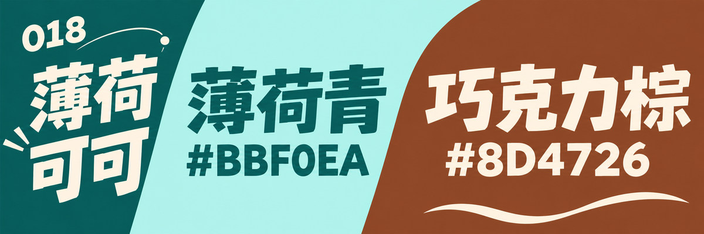 | 薄荷青 #BBF0EA 巧克力棕 #8D4726 |
| 019 极夜瀑布 | 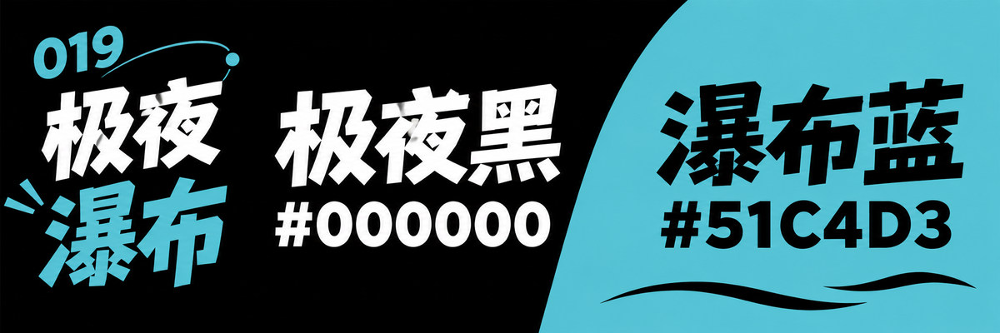 | 极夜黑 #000000 瀑布蓝 #51C4D3 |
| 020 暗夜橙光 | 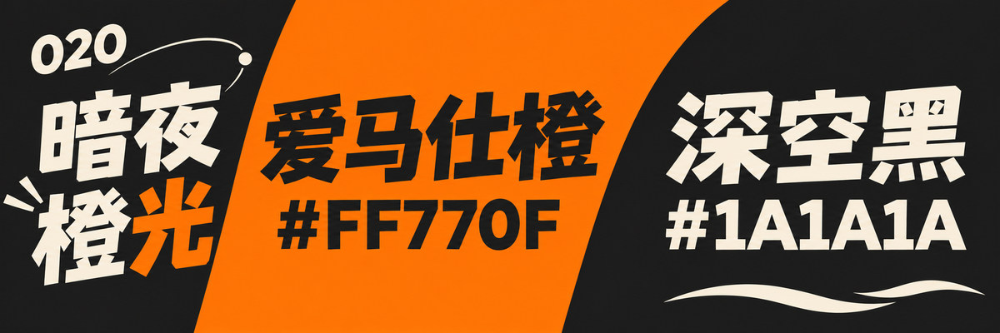 | 爱马仕橙 #FF770F 深空黑 #1A1A1A |

021—030

| 编号与名称 | 色卡 | 原始色号 |
| --- | --- | --- |
| 021 红黑经典 | 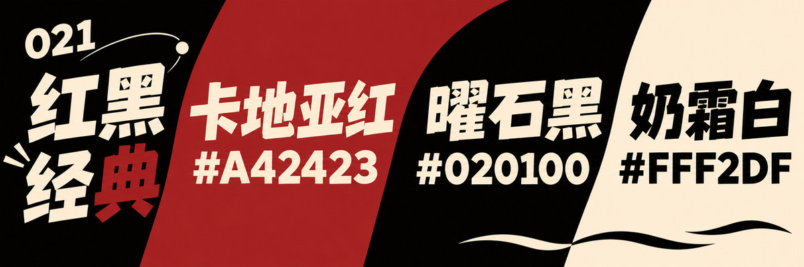 | 卡地亚红 #A42423 曜石黑 #020100 奶霜白 #FFF2DF |
| 022 橙棕暖意 | 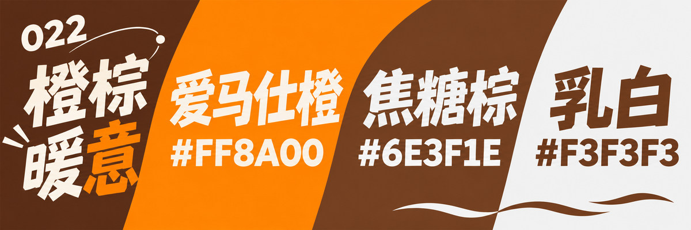 | 爱马仕橙 #FF8A00 焦糖棕 #6E3F1E 乳白 #F3F3F3 |
| 023 蓝湾微光 | 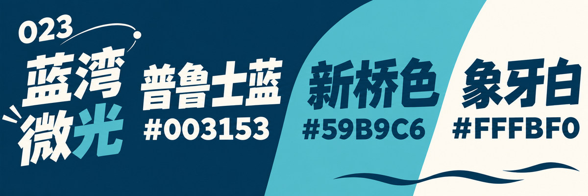 | 普鲁士蓝 #003153 新桥色 #59B9C6 象牙白 #FFFBF0 |
| 024 陶土青瓷 | 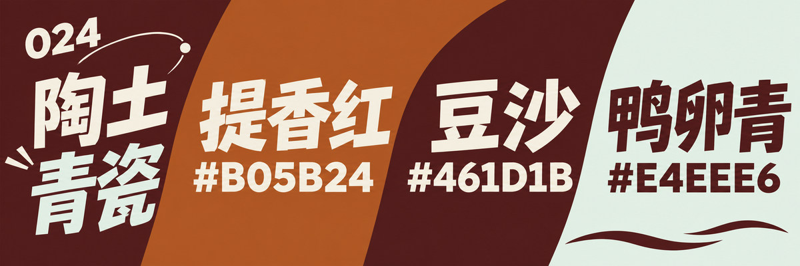 | 提香红 #B05B24 豆沙 #461D1B 鸭卵青 #E4EEE6 |
| 025 林间玄青 | 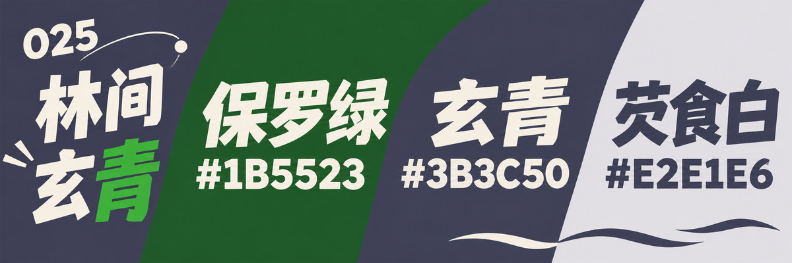 | 保罗绿 #1B5523 玄青 #3B3C50 芡食白 #E2E1E6 |
| 026 酒红旧梦 | 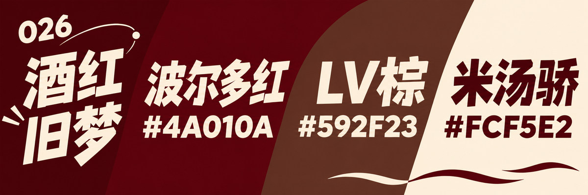 | 波尔多红 #4A010A LV棕 #592F23 米汤骄 #FCF5E2 |
| 027 夜海沙红 | 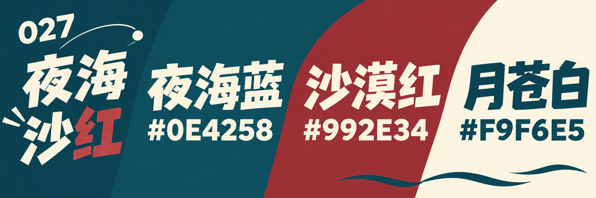 | 夜海蓝 #0E4258 沙漠红 #992E34 月苍白 #F9F6E5 |
| 028 番茄奶油 | 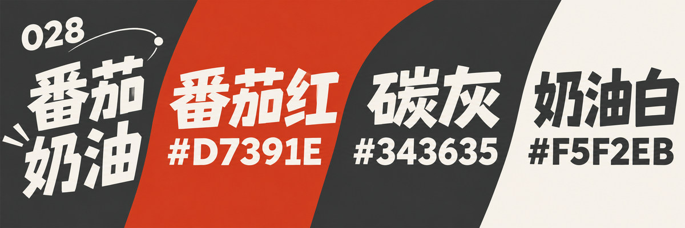 | 番茄红 #D7391E 碳灰 #343635 奶油白 #F5F2EB |
| 029 青绿桃雾 | 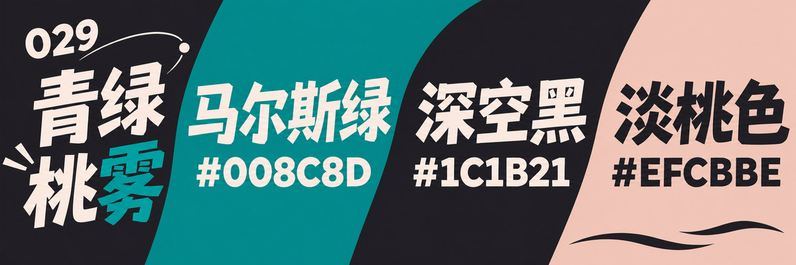 | 马尔斯绿 #008C8D 深空黑 #1C1B21 淡桃色 #EFCBBE |
| 030 落日与海 | 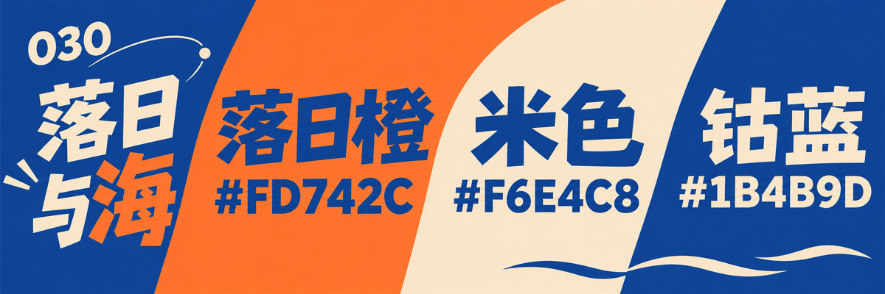 | 落日橙 #FD742C 米色 #F6E4C8 钴蓝 #1B4B9D |

031—040

| 编号与名称 | 色卡 | 原始色号 |
| --- | --- | --- |
| 031 云杉纸页 | 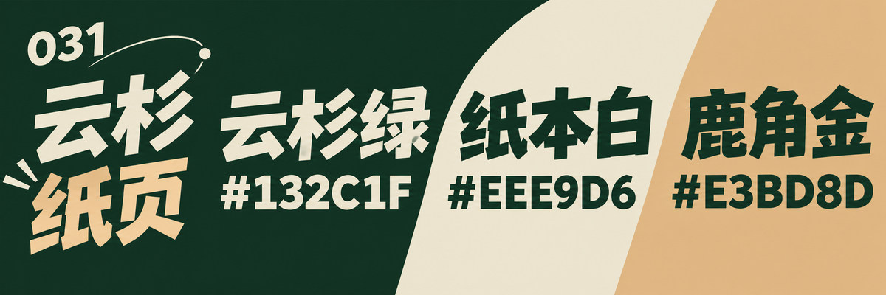 | 云杉绿 #132C1F 纸本白 #EEE9D6 鹿角金 #E3BD8D |
| 032 蓝调晴天 |  | 矢车菊蓝 #6496EB 拿坡里黄 #FDD95F 荷花白 #FEEEF1 |
| 033 蜜桃柔光 | 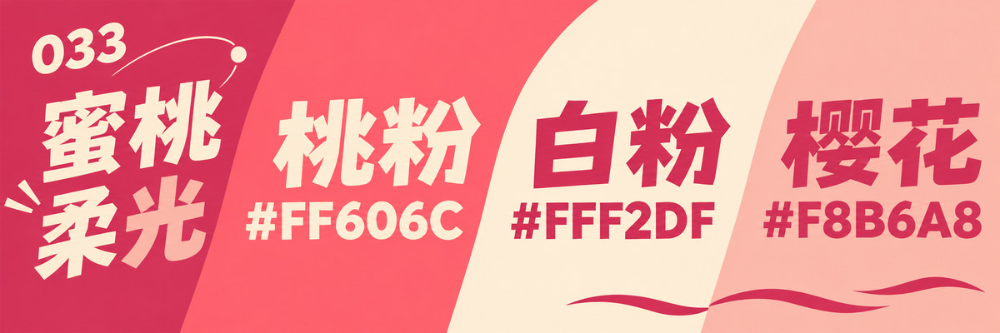 | 桃粉 #FF606C 白粉 #FFF2DF 樱花 #F8B6A8 |
| 034 红蓝序曲 | 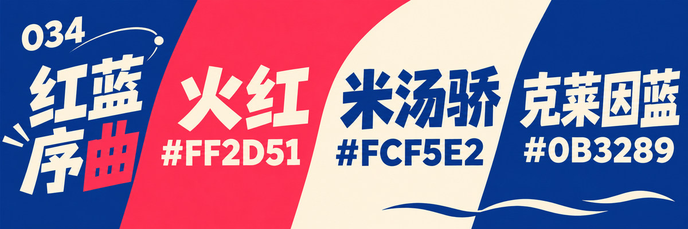 | 火红 #FF2D51 米汤骄 #FCF5E2 克莱因蓝 #0B3289 |
| 035 蓝白绯红 |  | 普鲁士蓝 #013E75 卡地亚红 #A42423 象牙白 #FFFBF0 |
| 036 粉蓝跳拍 | 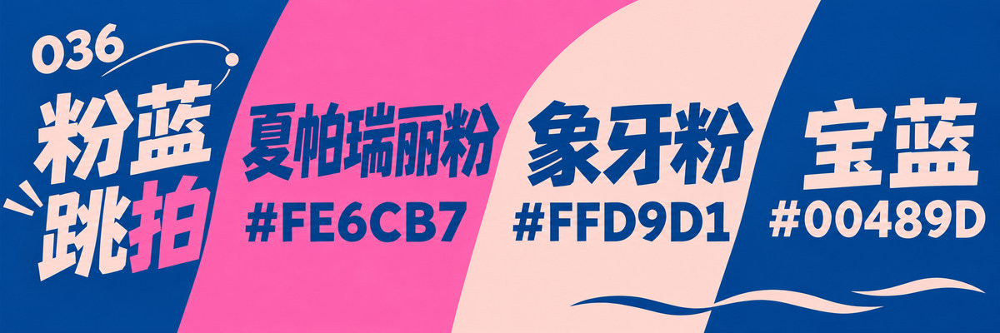 | 夏帕瑞丽粉 #FE6CB7 象牙粉 #FFD9D1 宝蓝 #00489D |
| 037 奶霜绿意 | 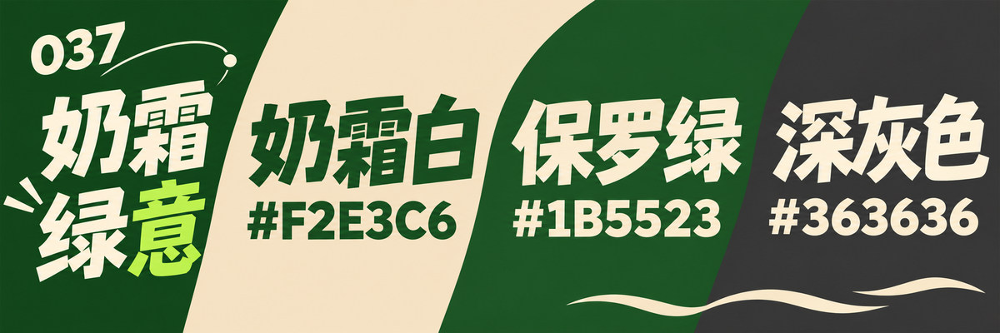 | 奶霜白 #F2E3C6 保罗绿 #1B5523 深灰色 #363636 |
| 038 酒香麦芽 | 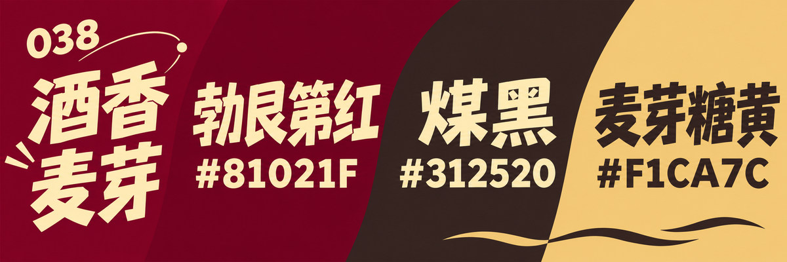 | 勃艮第红 #81021F 煤黑 #312520 麦芽糖黄 #F1CA7C |
| 039 橙蓝晴日 | 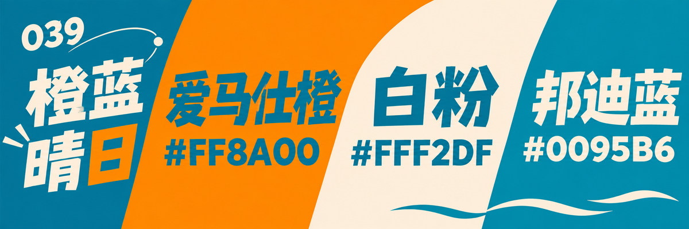 | 爱马仕橙 #FF8A00 白粉 #FFF2DF 邦迪蓝 #0095B6 |
| 040 森林蓝影 |  | 古驰绿 #1F4433 杜若色 #3E62AD 荔枝白 #FEFFEF |

041—050

| 编号与名称 | 色卡 | 原始色号 |
| --- | --- | --- |
| 041 草木微灰 | 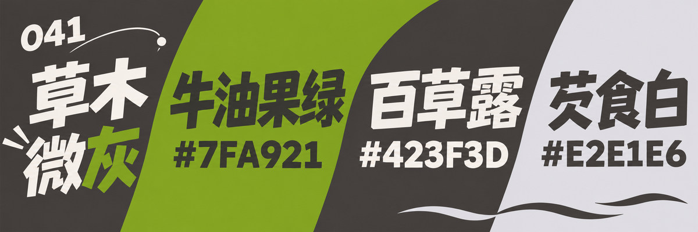 | 牛油果绿 #7FA921 百草露 #423F3D 芡食白 #E2E1E6 |
| 042 青瓷陶土 | 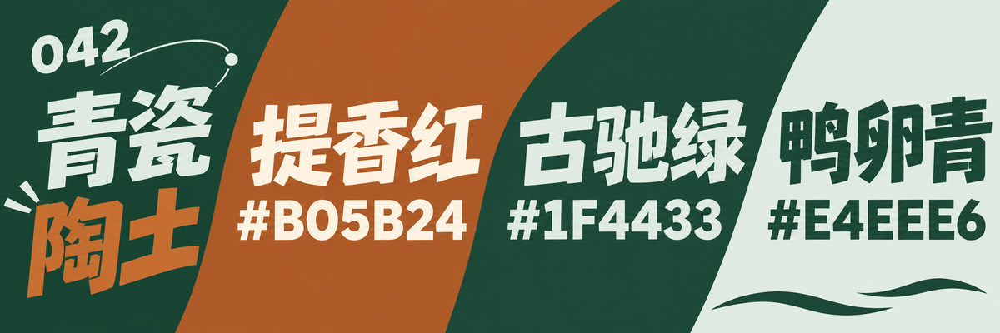 | 提香红 #B05B24 古驰绿 #1F4433 鸭卵青 #E4EEE6 |
| 043 金棕书页 | 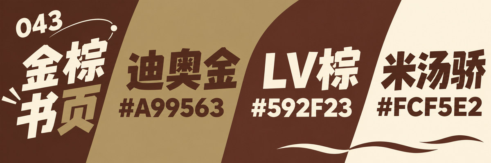 | 迪奥金 #A99563 LV棕 #592F23 米汤骄 #FCF5E2 |
| 044 橙光炭影 | 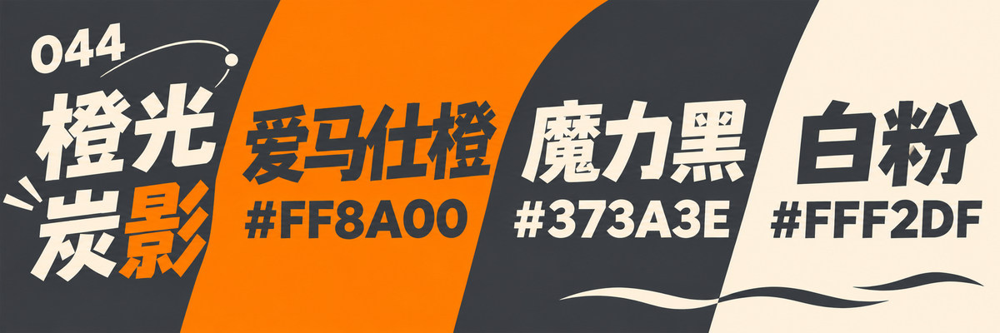 | 爱马仕橙 #FF8A00 魔力黑 #373A3E 白粉 #FFF2DF |
| 045 酒红奶白 |  | 波尔多红 #4A010A 鱼肚白 #FCEFE8 |
| 046 晴日三重 |  | 晴空蓝 #3498DB 阳光黄 #FEC107 活力橙 #E64A19 |
| 047 森林秋色 | 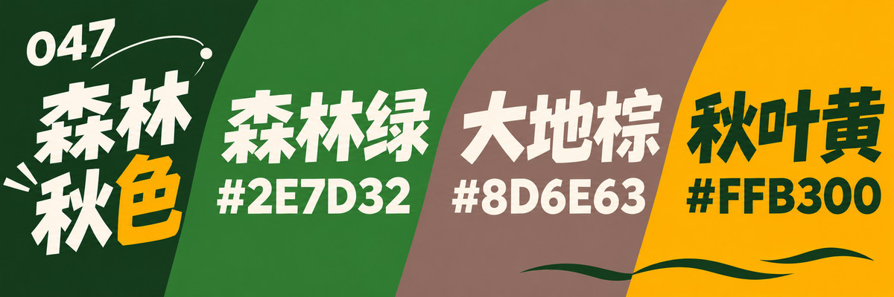 | 森林绿 #2E7D32 大地棕 #8D6E63 秋叶黄 #FFB300 |
| 048 海蓝粉雾 | 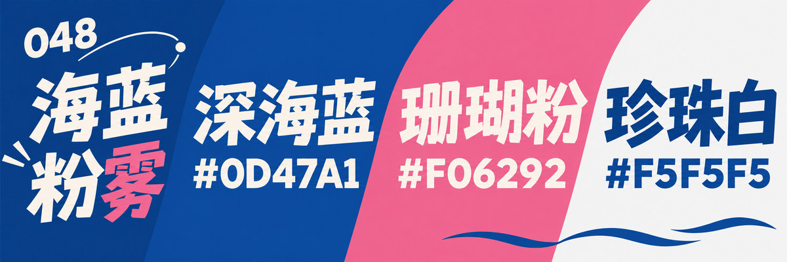 | 深海蓝 #0D47A1 珊瑚粉 #F06292 珍珠白 #F5F5F5 |
| 049 午夜霓虹 | 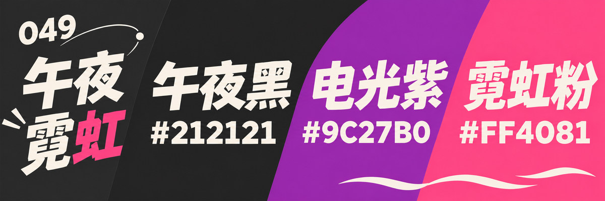 | 午夜黑 #212121 电光紫 #9C27B0 霓虹粉 #FF4081 |
| 050 摩卡焦糖 | 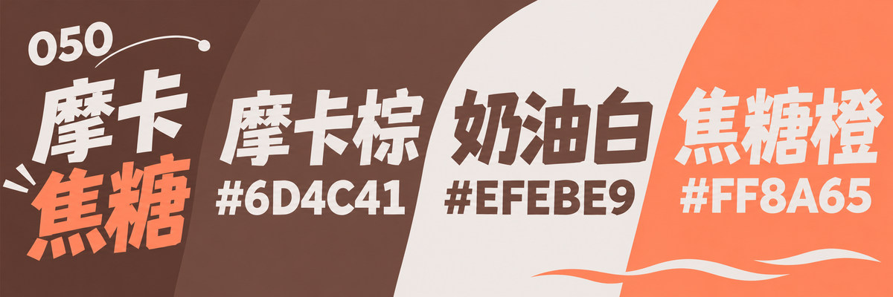 | 摩卡棕 #6D4C41 奶油白 #EFEBE9 焦糖橙 #FF8A65 |

051—060

| 编号与名称 | 色卡 | 原始色号 |
| --- | --- | --- |
| 051 三原节拍 | 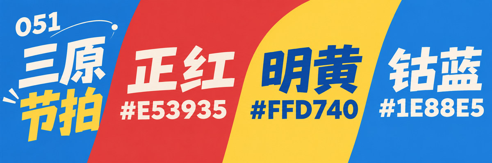 | 正红 #E53935 明黄 #FFD740 钴蓝 #1E88E5 |
| 052 水泥陶土 | 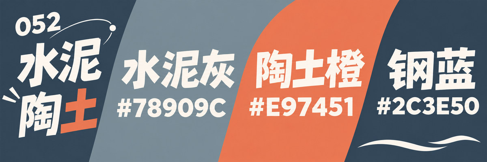 | 水泥灰 #78909C 陶土橙 #E97451 钢蓝 #2C3E50 |
| 053 杏白红蓝 |  | 米杏白 #FDF0D5 深海藏青 #003049 辣椒红 #D62828 |
| 054 青柠果香 | 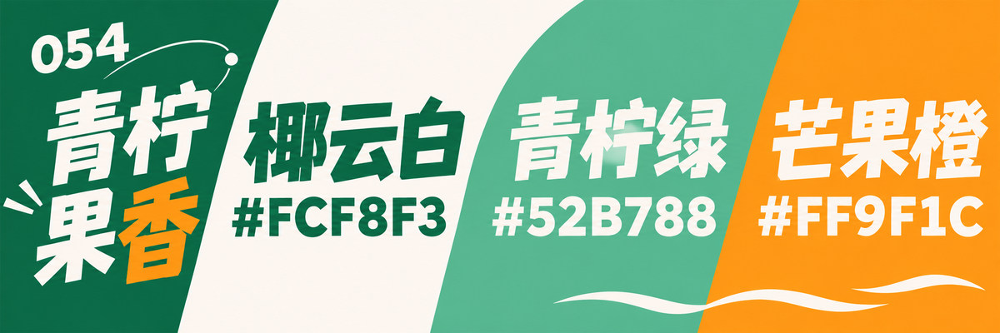 | 椰云白 #FCF8F3 青柠绿 #52B788 芒果橙 #FF9F1C |
| 055 奶咖雾色 | 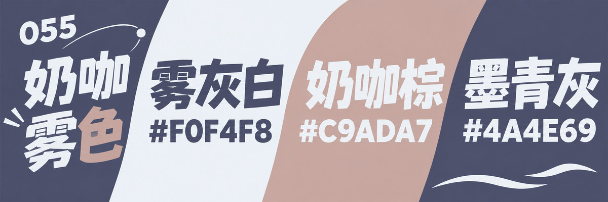 | 雾灰白 #F0F4F8 奶咖棕 #C9ADA7 墨青灰 #4A4E69 |
| 056 浆果草地 | 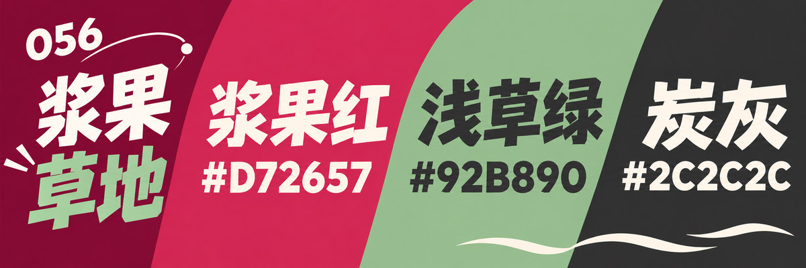 | 浆果红 #D72657 浅草绿 #92B890 炭灰 #2C2C2C |
| 057 蓝紫轻雾 | 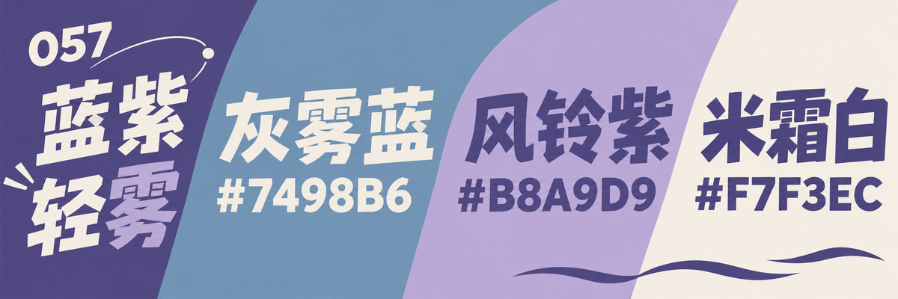 | 灰雾蓝 #7498B6 风铃紫 #B8A9D9 米霜白 #F7F3EC |
| 058 暗榄琥珀 | 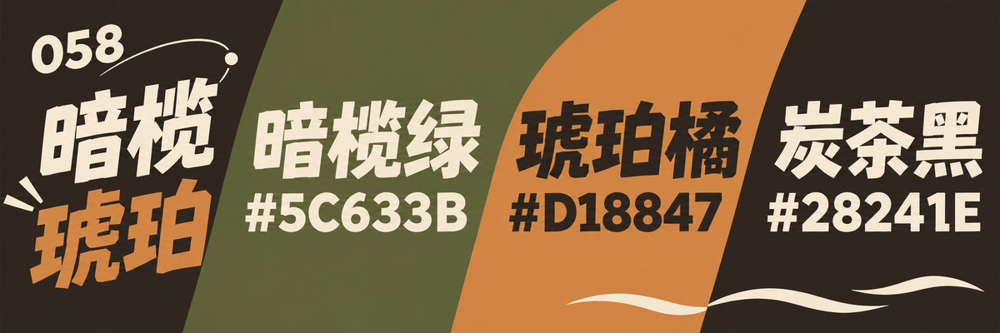 | 暗榄绿 #5C633B 琥珀橘 #D18847 炭茶黑 #28241E |
| 059 青蓝苏打 | 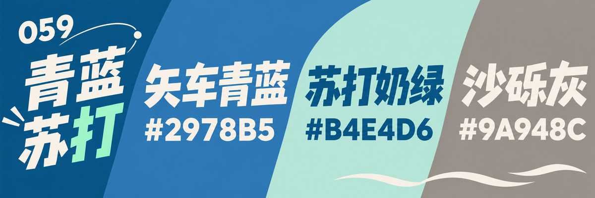 | 矢车青蓝 #2978B5 苏打奶绿 #B4E4D6 沙砾灰 #9A948C |
| 060 枣红奶咖 | 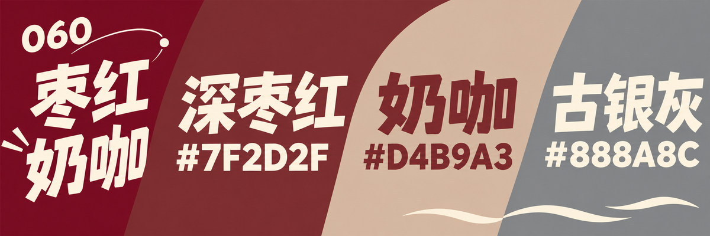 | 深枣红 #7F2D2F 奶咖 #D4B9A3 古银灰 #888A8C |

061—070

| 编号与名称 | 色卡 | 原始色号 |
| --- | --- | --- |
| 061 经典商务 | 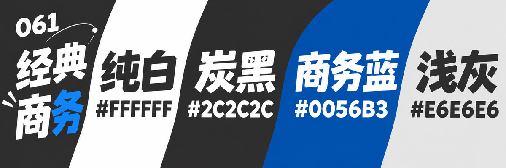 | 纯白 #FFFFFF 炭黑 #2C2C2C 商务蓝 #0056B3 浅灰 #E6E6E6 |
| 062 雅致书香 | 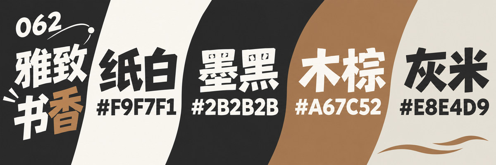 | 纸白 #F9F7F1 墨黑 #2B2B2B 木棕 #A67C52 灰米 #E8E4D9 |
| 063 自然森系 |  | 雾白 #F7F9F7 深林绿 #2D4F3C 鼠尾草绿 #6B9080 浅灰绿 #D8E2DC |
| 064 静谧裸粉 |  | 暖白 #FDFBF9 深咖棕 #4A3B38 豆沙粉 #C28B82 浅灰粉 #EBE0DE |
| 065 冷静科技 |  | 雾灰白 #F0F4F8 深海藏青 #102A43 钢蓝灰 #334E68 浅雾蓝 #D9E2EC |
| 066 摩登都市 |  | 纯白 #FAFAFA 炭灰 #333333 珊瑚红 #FF6B6B 浅灰 #EAEAEA |
| 067 纯粹极简 |  | 近白 #F8F8F8 墨黑 #1A1A1A 中灰 #8C8C8C 暖灰 #D4CFC9 |
| 068 深邃暗夜 |  | 极夜黑 #121212 淡紫 #BB86FC 浅灰白 #E0E0E0 深灰 #2C2C2C |
| 069 东方朱砂 |  | 纸白 #FDFCF8 墨黑 #2B2B2B 朱砂红 #B54935 灰米 #E6DCD3 |
| 070 数字先锋 |  | 明黄 #FFD23F 亮蓝 #0057FF 墨黑 #151515 纯白 #FFFFFF |

071—080

| 编号与名称 | 色卡 | 原始色号 |
| --- | --- | --- |
| 071 理性鲜明 |  | 明黄 #FFD23F 亮蓝 #0057FF 墨黑 #151515 |
| 072 年轻脉冲 |  | 荧光粉 #FF4081 荧光绿 #00E676 炭黑 #141414 |
| 073 平衡力量 |  | 琥珀橙 #FF8F00 青蓝 #00ACC1 炭黑 #171717 |
| 074 冷感实验 |  | 电光紫 #7C4DFF 青柠绿 #64DD17 近黑 #0F0F0F |
| 075 蓝橙先锋 |  | 活力橙 #FF6B35 晴空蓝 #2F80ED 近黑 #111111 |
| 076 绿橙活力 |  | 鲜绿 #00C853 珊瑚橙 #FF7043 近黑 #121212 |
| 077 沉静金光 |  | 青绿 #009688 琥珀黄 #FFB300 近黑 #181818 |
| 078 都会锐色 |  | 玫红 #FF2D55 靛蓝紫 #4F46E5 近黑 #161616 |
| 079 数字未来 |  | 亮紫 #A100FF 电光青 #00D9FF 近黑 #101010 |
| 080 深林薄荷 |  | 深林绿 #102F15 鼠尾草 #728C5A 浅黄绿 #EAF1B1 薄荷 #EBFADC |

081—090

| 编号与名称 | 色卡 | 原始色号 |
| --- | --- | --- |
| 081 军绿裸粉 |  | 暗影黑 #242115 军绿 #575C34 纽约粉 #C7736E 浅裸 #EBE1E1 |
| 082 苔藓粉境 |  | 丛林绿 #1C2A1A 苔藓绿 #405418 鼠尾草 #BBC397 肉粉 #FFC9C4 |
| 083 绿野骨白 |  | 酞菁绿 #103713 最大绿 #628B35 骨白 #E2DBD0 奶白 #FFFFFF |
| 084 麦穗可可 |  | 麦穗 #E2D1C9 麻棕 #B49D7D 铜溪 #A65F31 巧克力 #563822 |
| 085 水牛云山 |  | 水牛灰 #2F2F35 云山蓝 #2F90B9 |
| 086 晴蓝古鼎 |  | 晴蓝 #5698C3 古鼎灰 #36292F |
| 087 灰蓝掠影 |  | 苍蝇灰 #36282B 尼罗蓝 #2474B5 |
| 088 黄昏钴蓝 |  | 黄昏灰 #474B4C 钴蓝 #2B73AF |
| 089 安蓝长石 |  | 安安蓝 #3170A7 长石灰 #363433 |
| 090 飞燕牛角 |  | 飞燕草蓝 #0F59A4 牛角灰 #2D2E36 |

091—100

| 编号与名称 | 色卡 | 原始色号 |
| --- | --- | --- |
| 091 绿意茶白 |  | 马尔斯绿 #008C8D 茶白 #F3F9F1 |
| 092 珊瑚帝青 |  | 珊瑚赫 #C12C1F 帝释青 #003460 |
| 093 欧碧绛纱 |  | 欧碧 #C0D695 绛纱 #B27777 |
| 094 栀子群青 |  | 栀子 #FAC03D 群青 #2E59A7 |
| 095 深蓝鎏橘 |  | 骐驎 #12264F 库金 #E18A3B |
| 096 紫夜官绿 |  | 凝夜紫 #422256 官绿 #2A6E3F |
| 097 绿野玫粉 |  | 马尔斯绿 #01847F 玫瑰粉 #F9D2E4 |
| 098 天青朱砂 |  | 天青 #BFDEFF 朱砂 #D30121 |
| 099 琥珀青雀 |  | 琥珀黄 #F9B800 青雀头 #153C46 |
| 100 蓝白澄明 |  | 克莱因蓝 #0B3289 莹白 #E3F9FD |

